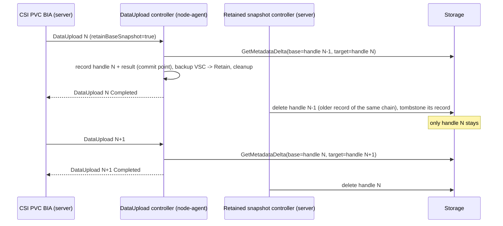

# Block Data Mover: Base Snapshot Retention for Storage Requiring Base Snapshot for Delta

## Abstract
Some storages can only compute changed blocks between two snapshots if the base (parent) snapshot still exists in the storage when `GetMetadataDelta` is called.
This design lets the Velero block data mover keep exactly one base snapshot per volume chain for such storages, decided by Velero configuration rather than by the VolumeSnapshotClass, and deletes it once a later backup no longer needs it or when its backup is deleted.

## Background
The [block data mover design][1] describes two kinds of storage in [Volume Snapshot Retention][2]:
> 1. Some storages don't require the parent snapshot itself at the time of calculating changes, then parent snapshot could be deleted immediately after the parent backup completes.
> 2. In order to calculate the changes, some storages require the parent snapshot mapping to the changeId always exists at the time of `GetMetadataDelta` is called, then the parent snapshot can NOT be deleted as long as there are incremental backups based on it.

This design calls them Case 1 and Case 2, as that section does.

This doesn't apply to snapshots that are not used through the Kubernetes CBT API, e.g., snapshots taken by a Velero volume snapshotter plugin.

The Kubernetes CBT API allows both cases and leaves the choice to the backup application.
[KEP-3314][3]:
> The `GetMetadataDeltaRequest` requires that the invoking backup application provide the **CSI snapshot handle** of the base snapshot against which changes are to be computed, and **not the name** of the base `VolumeSnapshot` object.
> [...]
> This supports storage infrastructures that do not require that the base `VolumeSnapshot` object exist in the cluster in order to generate changed block metadata against a later `VolumeSnapshot`.
>
> Note: It is the backup application's responsibility to determine if the underlying CSI driver provides this support.
> If it does, the backup application should take that into consideration in its snapshot retention policy, and should save the CSI snapshot handle somewhere for future use if it deletes the `VolumeSnapshot` object immediately after it has performed a backup.

For a driver without this support, the base snapshot must still exist in the storage, and the [CSI specification][4] lists `NOT_FOUND` for an invalid `base_snapshot_id`, so the delta call fails once the base snapshot is deleted.

On Velero main, the block data mover passes the snapshot handle of the backup VolumeSnapshotContent as changeId and the CSI volume handle of the source PersistentVolume as volume ID ([cbt.go][7]), and stores them as the `cbt-change-id` and `cbt-volume-id` tags of the repository snapshot ([snapshot.go L141-L149][8]).
Where a platform sets both in annotations of the VolumeSnapshot, they are read from there instead ([cbt.go L49-L58][43]); the changeId is then not the snapshot handle, and the volume ID can't be derived from the PersistentVolume.
The next backup reads the changeId of its parent repository snapshot and calls `GetChangedBlocks` with it.
If that fails, the uploader falls back to the allocated blocks of the current snapshot and the backup is reported as `fallbackFull` ([set.go][9], [snapshot.go L117-L134][10]).
So on Case 2 storages, every incremental becomes a full backup unless the base snapshot is retained.

velero-io/velero#10307 made the backup VolumeSnapshotContent inherit the `deletionPolicy` of the VolumeSnapshotClass ([csi_snapshot.go][11]), so a `Retain` class kept the snapshot.
Nothing deleted the retained snapshot later (velero-io/velero#10693).

**Decided in the 2026-10-27 community meeting:**
- Velero 1.19.0 doesn't support Case 2.
  The class-inherit part of velero-io/velero#10307 is rolled back, so the backup VolumeSnapshotContent is always `Delete`, as in 1.18.
  Reason: Velero can't track it when a user changes the class between `Retain` and `Delete`.
- Velero never reads the VolumeSnapshotClass `deletionPolicy` for data movement.
- The file system data mover never retains snapshots.
- Whether to retain is decided by Velero configuration (volume policy, storage class, driver), not by the snapshot class.
  Later it can be detected from the SnapshotMetadataService `requireBaseSnapshotForDelta` field.
- Case 2 is a separate design (this one), targeting a 1.19.x patch release.
  It must cover where the configuration comes from and how retained snapshots are tracked for deletion.

Everything below that is not in the list above is a proposal.
A prototype of the proposal ran on a Case 2 storage; see [Prototype Validation](#prototype-validation).
Its results are cited where they drove a choice.

## Goals
- Velero decides per volume whether to retain the base snapshot, from Velero configuration and, later, from the SnapshotMetadataService.
- Velero owns the lifecycle of a retained snapshot, independent of the VolumeSnapshotClass `deletionPolicy`, and deletes it when no later backup needs it or when its backup is deleted.
- Keep Case 1 storages and the file system data mover unchanged.

## Non Goals
- Keeping N snapshots per volume for fast restore from the snapshot (velero-io/velero#6240, velero-io/velero#7002).
  The design should stay compatible with it.
- Restoring from a retained snapshot.
  The retained snapshot is only a CBT base; restore still reads the backup repository.
- Retention for the file system data mover or for CSI snapshot backups without data movement.
- Migrating snapshots retained by pre-release builds through a `Retain` class.

## High-Level Design
When retention is enabled for a volume, the block data mover keeps the snapshot of its latest completed DataUpload in the storage, and only that one, per volume chain.
A volume chain is the set of repository snapshots the block data mover searches when it looks for a parent: same backup storage location, same source namespace, same source PVC.

- **Decide**: the CSI PVC BackupItemAction decides when it creates the DataUpload, from the volume policy, then the SnapshotMetadataService, then the default (don't retain), and writes the result into the DataUpload spec.
- **Retain**: when the data path completes, the node-agent writes an in-cluster record and the result into the DataUpload status (the commit point), then switches the backup VolumeSnapshotContent to `Retain` before the existing cleanup deletes it.
  A DataUpload that fails before the commit point never switches, so its snapshot is deleted as today; after the commit point, the DataUpload is finished, not canceled.
- **Rotate**: once a later DataUpload of the same chain completes and nothing else in the chain is running, the previous retained snapshot is no longer the base of any future backup, so Velero deletes it and keeps its record as a tombstone.
- **Backstop**: deleting a backup deletes its retained snapshot if it still exists; a controller also deletes retained snapshots whose source volume or Backup is gone.



## Detailed Design

### Retention Decision
The decision is made per volume in the CSI PVC BackupItemAction, where it creates the DataUpload ([pvc_action.go L405-L419][12], `newDataUpload` [L553-L631][13]).
This is where the data mover from the volume policy is already resolved, so the decision is made once per DataUpload and doesn't change while the DataUpload runs.

Precedence, first match wins:
1. The `retainBaseSnapshot` parameter of the volume policy `snapshot` action, `true` or `false`.
2. `spec.requireBaseSnapshotForDelta` of the SnapshotMetadataService CR named after the CSI driver, `true` or `false` (`nil` falls through).
3. Default: don't retain.

Retention only applies when the resolved data mover is the block data mover; otherwise the decision is `false` and no other source is read.

The decision is logged at info level once per DataUpload, with its value and source, and stored in the DataUpload annotation `velero.io/base-snapshot-retention` for describe, e.g., `false (from default: no volume policy matched; SnapshotMetadataService csi.example.com has no requireBaseSnapshotForDelta)`:
- volume policy: the index of the matched entry, since several entries can match the same volume;
- SnapshotMetadataService: its name;
- default: the reasons of every source that fell through, in precedence order, joined with `; `:
  - volume policy: `no volume policy matched` or `matched volume policy <index> has no retainBaseSnapshot`;
  - SnapshotMetadataService: `no SnapshotMetadataService for <driver>` (also when its CRD is not installed), `SnapshotMetadataService <name> has no requireBaseSnapshotForDelta`, or `reading SnapshotMetadataService failed: <error>`;
- data mover: `data mover "<name>" is not "velero-block"`.

In the prototype, "from default" without a reason left these cases indistinguishable.

#### Volume Policy Parameter
[Volume Snapshot Retention][2] planned a parameter in `Action.Parameters`:
> The interface could be added to the `Action.Parameters` of Volume Policy. By default, Velero block data mover takes Way 1, so volume snapshot is never retained; if users specify `RetainSnapshot` parameter, Way 2 will be taken.

This design names it `retainBaseSnapshot` to:
- follow the camelCase of the existing `dataMover` and `snapshotClass` parameters ([resource_policies.go L53-L61][14]);
- keep `retainSnapshot` free for velero-io/velero#6240, where the snapshot is kept for restore, not as a CBT base.

```yaml
version: v1
volumePolicies:
- conditions:
    csi:
      driver: csi.example.com
  action:
    type: snapshot
    parameters:
      dataMover: velero-block
      retainBaseSnapshot: true
```

Following the existing parameters:
- `const RetainBaseSnapshotParameter = "retainBaseSnapshot"` in `internal/resourcepolicies`.
- `func (a *Action) GetRetainBaseSnapshot() (*bool, error)`, returning `nil` when the parameter is absent so the next source is used.
- The volume helper gets a `GetRetainBaseSnapshotFromActionParameters` next to `GetDataMoverFromActionParameters` ([volume_policy_helper.go L511][15]).

The resource policy validator fails the backup with `FailedValidation` when:
- the value is not a YAML boolean or exactly the string `"true"` or `"false"`; the error shows the received value and the allowed ones, and a YAML null (`~` or an empty value) as `got null`.
  Resource policies are decoded as YAML 1.2, so an unquoted `true` or `false` in any case form, e.g., `TRUE`, is a boolean; `yes`, `1`, `"TRUE"` and every other string are rejected.
  `strconv.ParseBool` is not used because it also accepts `1`, `t` and the string `"TRUE"`;
- the parameter is on any action type other than `snapshot`;
- `retainBaseSnapshot: true` is set without `dataMover: velero-block` in the same action.
  `Action.GetDataMover` returns the default built-in data mover when `dataMover` is absent, and that overrides the Backup's `datamover` ([resource_policies.go L87-L114][32]), so the parameter would silently do nothing.
  When `dataMover` is absent, the error says so and names the default that would be used, e.g., `parameter "retainBaseSnapshot" is true but the action has no "dataMover" (the default data mover "velero-fs" would be used), it must be "velero-block"`.
  `retainBaseSnapshot: false` is valid with any data mover.

The validation error must name the policy ConfigMap (`Spec.ResourcePolicy.Name`).
Today the error for a Backup names the Backup as the ConfigMap ([resource_policies.go L653-L687][42]); with retention, validation is the main place users see a misconfiguration.

Unknown keys in `snapshot` action parameters (anything but `dataMover`, `snapshotClass` and `retainBaseSnapshot`) are logged and added as a backup warning, once per key and volume policy entry when the backup validates its resource policy, not once per volume.
In the prototype, a misspelled `retainBaseSnapshots: true` passed validation, turned retention off, and that DataUpload rotated out the chain's retained snapshot.

Users select volumes by any existing condition, e.g., `storageClass` or `csi.driver`.

#### SnapshotMetadataService
kubernetes-csi/external-snapshot-metadata#258 (merged, not released yet) added `spec.requireBaseSnapshotForDelta` (`*bool`) to the SnapshotMetadataService CRD: `true` means retain the base snapshot, `false` means it can be deleted, unset gives no guidance.
CSI drivers that need the base snapshot are expected to set it to `true`.
Reading it is tracked by velero-io/velero#10722.

Velero can read the field from the unstructured CR, so no Velero dependency bump is needed (Velero main uses v1.0.0).
What gates it is the CRD installed with the CSI driver: a CRD without the field prunes it, so the CR never has it.
Until driver deployments ship the updated CRD, this source falls through, and the decision log says the field is unset.
If the CR or the field doesn't exist, or the CR can't be read, the decision falls through to the default and the reason is logged.

#### DataUpload Spec
The decision is recorded in a new DataUpload spec field so that the node-agent doesn't need the volume policy or the SnapshotMetadataService:
```go
type DataUploadSpec struct {
	...
	// RetainBaseSnapshot indicates the data mover to keep the volume snapshot
	// in the storage after the data movement completes, as the base of the
	// next incremental backup of the same volume.
	// +optional
	RetainBaseSnapshot bool `json:"retainBaseSnapshot,omitempty"`
}
```

The CSI PVC BackupItemAction also labels every block DataUpload with `velero.io/base-snapshot-chain`, a hash of its chain key, so the controllers list one chain by label.
The CSI PVC RestoreItemAction puts the same label on the DataDownload of an in-place incremental restore of a backup with retention.

#### Configuration Changes Between Backups
- Retention turned on: the previous backup kept no snapshot, so the first backup after the change falls back to allocated blocks and retains its snapshot; the one after is incremental.
- Retention turned off: the backup after the change runs incremental on the retained snapshot, retains nothing, and its completion rotates out the previous retained snapshot, by the same rule as below.
  The storage is only freed then: until the chain's next backup completes, or its latest backup is deleted or expires, the retained snapshot stays.
  An expired backup is deleted by the next garbage collection run (`--garbage-collection-frequency`, default `1h`), so its snapshot can outlive the TTL by up to that interval.
  The same holds when a volume leaves the backup scope.
- Data mover changed from block to file system: the file system data mover doesn't write block repository snapshots, so the block parent lookup still finds the last block repository snapshot, whose changeId is the retained snapshot.
  So a file system DataUpload doesn't rotate the block chain, and switching back to the block data mover resumes incrementals (validated by the prototype).
  The retained snapshot is otherwise deleted with its backup.

### Snapshot Lifecycle
When `retainBaseSnapshot` is `false`, behavior is that of 1.19.0 after the rollback: the backup VolumeSnapshotContent is `Delete` and the exposer cleanup deletes the snapshot ([csi_snapshot.go CleanUp][16]).

When it is `true`, Velero owns the snapshot.
[Volume Snapshot Retention][2] planned to keep it from the start of the backup:
> - At the end of each backup, keep the current VolumeSnapshot's `deletionPolicy` as `Retain`, then when the VolumeSnapshot is deleted at the end of the backup, the current snapshot is retained in the storage

This design switches to `Retain` only after the data path completes and the record is written, so a failed or interrupted data movement never leaves a retained snapshot behind.
The VolumeSnapshotClass `deletionPolicy` is never read.
The exposer still creates the backup VolumeSnapshotContent with `Delete`, and the source VolumeSnapshotContent is still retained and deleted during expose ([csi_snapshot.go L207-L231][17]), so during the data movement the snapshot is owned by the backup VolumeSnapshotContent, as today.

In `OnDataUploadCompleted` ([data_upload_controller.go L483-L536][18]), before the exposer cleanup:
1. Read the snapshot handle, driver and deletion secret annotations (`snapshot.storage.kubernetes.io/deletion-secret-name`/`-namespace`, copied from the source VolumeSnapshotContent) from the backup VolumeSnapshotContent, and the cluster identity (see Ownership Across Clusters).
2. Create the in-cluster record (see Tracking), then write the data path result (snapshot ID, sizes, `snapshotStartTime`) and `status.retainedSnapshot` to the DataUpload; the phase stays `InProgress`.
   This is the commit point.
3. Patch the backup VolumeSnapshotContent `deletionPolicy` to `Retain`.
4. Run the exposer cleanup, which deletes the backup VolumeSnapshot and VolumeSnapshotContent objects and leaves the snapshot in the storage.
5. Set the phase to `Completed`.

The record is written before the snapshot becomes `Retain`, so Velero never has a retained snapshot it doesn't know about.

**Commit point.** Today the data path result is written only together with `Completed`, after the cleanup.
If the node-agent restarts during the cleanup, resume fails because the exposed pod is already gone, and the DataUpload is canceled ([data_upload_controller.go L1128-L1149][33]).
But its repository snapshot is already saved, and the parent lookup doesn't look at the DataUpload outcome.
So the next backup picks it as parent, asks for a delta against its deleted snapshot, falls back, and on completion rotates out the snapshot that was kept for it.
In the prototype, steps 1-3 took about 27 ms and the cleanup about 16 s, so a node-agent restart during completion almost always hit the cleanup and caused this.

Proposal: after step 2 the DataUpload always completes.
A DataUpload with `retainBaseSnapshot: true` is past the commit point when it has a persisted data path result (`status.snapshotID` set) and its phase is not final, with or without `status.retainedSnapshot`.
The DataUpload controller finishes such a DataUpload whenever no data path runs for it, on node-agent restart or on its next reconcile (see step 3 below for the periodic requeue), instead of canceling it: it runs steps 3-5 when `status.retainedSnapshot` is set, otherwise steps 4-5.
These steps are idempotent.
A cancel request after the commit point is ignored, including the one the Velero server sets when it restarts during the backup ([server.go L1016][38]); that Backup is still marked `Failed`, as today.
The node-agent logs once per DataUpload that it ignores the cancel request and why, as `spec.cancel` stays set on the completed DataUpload, whether the request arrives while the completion callback still runs or later.
This design needs it only for DataUploads with retention; doing it for all DataUploads would also keep a backup whose data is already in the repository from ending `PartiallyFailed`.

Today only the node-agent of `status.node` resumes a DataUpload ([data_upload_controller.go L1113-L1127][45]).
Since a cancel is ignored after the commit point, a committed DataUpload whose node never gets a node-agent back would stay `InProgress` and pause its chain for good; the backup's item operation timeout only sends that cancel.
Proposal: steps 3-5 are API calls and don't need the node, so any node-agent finishes a committed DataUpload when no ready node-agent pod runs on its `status.node`.
It first takes it over with an update conditioned on the resourceVersion that sets `status.node` to its own node, so only one node-agent does, and a node-agent restarting on the old node skips it as resumed by another node.

Errors without a restart:
- Step 1 fails, e.g., the backup VolumeSnapshotContent has no handle: retention is skipped.
  No record is written, step 2 writes the result without `status.retainedSnapshot` and sets the DataUpload message `base snapshot not retained: <error>`, the cleanup deletes the snapshot, and the DataUpload completes.
- Step 2 fails after the retries `UpdateDataUploadWithRetry` already does: the DataUpload is not committed.
  The node-agent deletes the record if it created it, runs the cleanup, and completes the DataUpload as today, without retention.
  If that fails too, the DataUpload is left as today; the controller handles the record (see Rotation and GC).
- Step 3 fails: the DataUpload stays `InProgress` and is retried every 30 seconds.
  Step 3 runs in the data path completion callback, outside a reconcile, so a failure there triggers no reconcile; the periodic enqueue source of the DataUpload controller ([data_upload_controller.go L667-L686][44]), which today selects only accepted DataUploads, canceled ones not yet final, and final ones being deleted, also selects DataUploads past the commit point that are not in a final phase.
  While `status.retainedSnapshot` is set, the cleanup never runs on a backup VolumeSnapshotContent that is still `Delete`, as it would delete a recorded snapshot.
  A backup VolumeSnapshotContent that is not found means step 4 already ran after step 3 succeeded, e.g., before a restart, so the DataUpload continues with step 4.
  At the first failure, the node-agent sets the DataUpload annotation `velero.io/retain-failing-since` to the time, so a node-agent restart doesn't restart the window.
  If step 3 still fails 10 minutes after that time, the node-agent abandons retention: it reads the backup VolumeSnapshotContent again, and if it is already `Retain`, step 3 had succeeded and the DataUpload continues with step 4.
  Otherwise it clears `status.retainedSnapshot` and sets the message, deletes the record, runs the cleanup and completes.
  If the read itself fails, it keeps retrying, as abandoning a `Retain` snapshot would leak it.

Abandoning keeps the backup and its data, at the cost of one fallback for the next backup; leaving the DataUpload `InProgress` would block the backup until its item operation timeout.

| Interrupted | State | Recovery |
|---|---|---|
| before step 2 completes | backup VolumeSnapshotContent is `Delete`; maybe a record | if the data mover pod finished and still holds the result, e.g., a node-agent restart before step 1, the restarted node-agent resumes from it, runs the completion, and nothing is lost. Otherwise, when the result is lost with the pod or the DataUpload fails or is canceled: cleanup deletes the snapshot; the controller handles the record of a non-completed DataUpload; deleting an absent handle succeeds. If the repository snapshot was already saved, the next backup falls back once and rotates out the previous base. |
| step 3 or 4 | result persisted, record exists | the node-agent finishes steps 3-5 after restart; nothing is lost |
| while abandoning retention | result persisted, maybe `status.retainedSnapshot`, maybe a record | the node-agent finishes as above: steps 3-5 if `status.retainedSnapshot` is still set, otherwise steps 4-5; the controller handles a record the completed DataUpload doesn't name |
| DataUpload still ends `Failed` or `Canceled` after step 2 | record exists, `status.retainedSnapshot` set | the failure path patches the backup VolumeSnapshotContent back to `Delete` if it exists, and the controller deletes the handle from the record; both may run, as deletion is idempotent. The next backup falls back once. |

Such a DataUpload goes into the backup tarball with `status.retainedSnapshot` set; the DataUpload delete action ignores `retainedSnapshot` on DataUploads that are not `Completed`, as the controller owns their records.

The failure path covers failed, canceled and prepare timed out DataUploads, and DataUploads marked failed or canceled after a node-agent or Velero server restart.
velero-io/velero#10708 covers the source VolumeSnapshotContent left by an interrupted expose; it is separate from this design but needed for no leaks.

### Which Snapshots Are Kept
Proposal: keep only the latest retained snapshot per chain.

**Chain key**: the block data mover finds the parent as the latest repository snapshot, by start time, with the same source, requester and the `block` uploader ([findPreviousSnapshot][19]).
The source is `<namespace>/<pvc>` ([util.go][20], [block.go L131-L132][21]) in the backup repository of the DataUpload's backup storage location and source namespace ([backup_micro_service.go L189-L199][22]).
So the chain key is `(backupStorageLocation, sourceNamespace, sourcePVC)`: one retained snapshot per PVC per backup storage location.
- Two schedules backing up the same PVC to the same location share one chain, because the parent lookup doesn't look at the schedule; full and incremental schedules of the same PVC also share it. [Selectable Backup Type][23] suggests exactly that setup:
  > As a workaround, users could create two schedules for the same scope of backup, one is for full backups, with less frequency and longer backup TTL; the other one is for incremental backups, with normal frequency and shorter backup TTL.

  The retained snapshot belongs to whichever backup of the PVC ran last.
  Deleting that backup, or its expiry, makes the next backup of the PVC fall back once, whatever schedule it comes from.
  Overlapping schedules with different TTLs are usually fine, because the expiring backup is rarely the latest; it shows when the schedule that ran last is paused or removed and its backups expire.
- The same PVC backed up to N locations has N chains, so N retained snapshots.
- A PVC deleted and recreated with the same name keeps the chain key, but the parent's `cbt-volume-id` tag no longer matches the volume, so the backup falls back ([snapshot.go L211-L213][24]); the old retained snapshot is rotated out by the next completed DataUpload as usual.

**Rotation rule**: when a DataUpload of a chain completes, every retained snapshot of that chain whose repository snapshot started earlier is deleted.
This applies whether or not the new DataUpload retained its own snapshot, and whether it was incremental or fell back.
- Order: by repository snapshot start time, the order the parent lookup uses, so the kept snapshot is always the base of the next backup's parent.
  The data path result doesn't carry it today ([types.go L32-L44][36]).
  This design adds it to the data path result and to every completed block DataUpload, with or without retention, as `status.snapshotStartTime`, and copies it into the record.
  The controller compares the `snapshotStartTime` of the latest completed block DataUpload of the chain with the start time of each live record.
  Both are kept at microsecond precision (`metav1.MicroTime`); `metav1.Time` has second precision and would make equal start times common.
  A DataUpload without it, completed before the upgrade, doesn't rotate.
  The DataUpload `startTimestamp` has second precision and is set before the upload starts; the VolumeSnapshotContent `status.creationTime` follows snapshot order, which under concurrent backups of one PVC can differ from upload order.
  Neither matches the parent lookup.
  Equal start times keep both snapshots; the next completion resolves it.
- Pause: while any DataUpload of the chain is not in a final phase, an in-place incremental DataDownload of the chain is not final, or an in-place restore holds a record (see Decision window), the controller doesn't rotate and doesn't delete snapshots whose source volume is gone; it requeues.
  Otherwise a DataUpload that started earlier but is still reading changed blocks can lose its base, and an in-place restore, which recreates the PVC, can lose its base between its check and its `GetMetadataDelta` call.
  The pause check lists the DataUploads and DataDownloads of the chain from the API server, right before the conditioned update to `deleting`, so a DataDownload just created isn't missed by a stale cache.
  What starts after that list is still safe: a DataUpload uses the newest repository snapshot as parent, whose base is the snapshot rotation keeps, and an in-place restore holds the record with a conditioned update, which fails if the controller moved it to `deleting` first.
  Finishing `deleting` records, deleting snapshots of DataUploads that ended without completing, and GC by Backup continue during a pause: they don't touch the base of a running DataUpload or DataDownload, except after a DataUpload failed past its commit point, where the failure path deletes the snapshot anyway.
  A DataUpload that never reaches a final phase, e.g., when its data mover pod disappears without reporting a result, pauses its chain until the backup's item operation timeout ends it; meanwhile the storage holds that DataUpload's snapshot in addition to the retained one.
  A DataUpload past the commit point is not ended by that timeout; another node-agent finishes it if its node has none (see Commit point).

The previous snapshot is deleted only after the new DataUpload completed, never before the new snapshot is taken.
Unlike the count-limit rotation of velero-io/velero#7002, a failed backup never loses its base, provided it fails before the commit point.
During a backup, the storage holds the retained snapshot plus the snapshot of each running backup of the chain.

Proposal: rotation is triggered by DataUpload completion, not by the backup phase.
Once the new repository snapshot is saved it is the parent of the next backup, regardless of whether its backup ends `Completed`, `PartiallyFailed` or `Failed`.

**Backup deletion**: deleting a backup deletes the retained snapshots recorded for it, if they still exist.
Only the latest backup of a chain still has one, so deleting it makes the next backup fall back to allocated blocks: its parent becomes the previous repository snapshot, whose base snapshot was already rotated out.
Keeping the snapshot would not help, because no repository snapshot names it as changeId once the backup's repository snapshot is deleted.
Deleting any other backup only removes its tombstone.

**Consequences of keeping one snapshot**:
- In-place incremental restore ([in-place restore design][25]) also calls `GetMetadataDelta` with the backup's changeId ([snapshot.go L240-L252][26]).
  On Case 2 storages, only a backup whose snapshot is still retained when the restore runs, normally the latest of its chain, can be restored incrementally in place; others are restored in place as full (see below).
- The snapshot of a backup taken in another cluster is not available, so the same applies after migration.
- An in-place restore keeps the volume, so the chain continues; the next backup's delta includes every block the restore rewrote.
  The restore recreates the PVC over the same PersistentVolume, so the PVC UID changes but the volume doesn't; GC compares the volume, so the base stays (see Rotation and GC).

### In-Place Incremental Restore
Today, when the base is gone, the restore takes a baseline snapshot of the target volume that is never used, falls back to full, and reports it only as `incremental (fallen back to Full)` in `velero restore describe --details`.
The driver error can't tell why: a driver may return another code than `NOT_FOUND` for a missing base, e.g., `Internal` in the prototype.

Proposal: for a backup whose DataUpload had `retainBaseSnapshot: true`, the CSI PVC RestoreItemAction decides before it takes the baseline snapshot ([pvc_action.go L259-L274][35]), or, with namespace mapping, before it uses the source VolumeSnapshot of the existing PVC.
Backups without retention, including every backup on a Case 1 storage, restore in place as today.
On a Case 2 storage this means a backup without retention takes a baseline snapshot it can't use, fails at `GetMetadataDelta` and restores as full with a warning, on every in-place incremental restore (`deltaError` with a hint that the base wasn't retained, or `baseNotRetained` when the driver reports `requireBaseSnapshotForDelta: true`).
Proposal: when the SnapshotMetadataService of the driver has `requireBaseSnapshotForDelta: true`, the action handles a backup without retention as below with `baseNotRetained`: it skips the baseline snapshot and restores in place as full.
The driver is the `spec.csi.driver` of the PersistentVolume the existing PVC is bound to; without one, the restore proceeds as today.
Until drivers ship that field, such restores keep falling back on the driver error.

The action only reads the DataUpload result that the DataUpload retrieve action writes ([dataupload_retrieve_action.go L75-L87][39]), not the DataUpload.
The retrieve action adds to `DataUploadResult`, from the backup's DataUpload, its name, the source PVC, `retainBaseSnapshot` and `retainedSnapshot`.
`DataUploadResult` is stored in a ConfigMap, so this needs no CRD change.

The action finds the record by the DataUpload name (see Tracking) and decides:
- live record: hold it (see Decision window) and proceed as today;
- no record, and `retainedSnapshot` set with the cluster identity of this cluster or none (e.g., after reinstall, or written through an older CRD): proceed as today;
- otherwise skip the baseline snapshot and restore in place as full, with a reason and a message:
  - `deleting` or `deleted` record: `baseGone`, e.g., `base snapshot of backup b5 was rotated out at <time> by backup b6`, or `base snapshot of backup b5 was deleted with the backup`; a `deleting` record is described by the reason and `rotatedBy` it already carries, e.g., `base snapshot of backup b5 is being rotated out by backup b6`;
  - no `retainedSnapshot`: `baseNotRetained`, `base snapshot of backup b5 was not retained`;
  - `retainedSnapshot` of another cluster: `baseInOtherCluster`, `base snapshot of backup b5 was taken in cluster <id>`.
- the record or the cluster identity can't be read, or the hold fails for another reason than a conflict: proceed as today, so a transient error costs at most a fallback on the driver error.
  A conflict rereads the record and decides again, up to 5 times.

A RestoreItemAction can't return warnings ([restore_item_action_shared.go L39-L64][40]), and the DataDownload status is written by the DataDownload controller in the node-agent.
So the reason travels as follows:
- the action creates the DataDownload with `restoreType: full` and the annotations `velero.io/in-place-fallback-reason` and `velero.io/in-place-fallback-message`;
- the DataDownload controller copies them to `status.fallbackReason` and `status.message` when the DataDownload reaches a final phase.
  When an incremental restore falls back on a driver error, it sets `deltaError` and refines it as the DataUpload controller does (see CLI), from the record of the changeId the restore asked the delta against, which the data path restore result gains, e.g., `baseGone` with `base snapshot of backup b6 was rotated out at <time> by backup b7`.
  Only a DataDownload with the chain label is refined by record, as listing every record of the namespace doesn't scale with tombstones.
  A backup without retention has no record to find; its DataDownload carries the annotation `velero.io/base-snapshot-retained: "false"`, set by the action from the DataUpload result.
  Its `deltaError` becomes `baseNotRetained` only when the SnapshotMetadataService of the driver has `requireBaseSnapshotForDelta: true`, as only then is the missing base known to be the cause, e.g., `base snapshot of backup b5 was not retained`.
  Otherwise it stays `deltaError`, and the message adds `base snapshot of backup b5 was not retained` as a hint next to the driver error, since on a Case 1 storage the failure has another cause.
  Unlike a backup, whose parent may come from an earlier configuration, the base of an in-place restore is the backup's own snapshot, and the DataUpload result says Velero deleted it after the backup.
  The message also carries the driver error, as the data mover pod and its log are gone after the restore, so on a Case 1 storage, where the delta doesn't need the base, the real cause still shows;
- the restore finalizer, which already copies DataDownload results into the restore volume info ([restore_finalizer_controller.go L597-L614][41]), also copies the reason and message, and adds one restore warning per DataDownload with a `fallbackReason`.

`velero restore describe --details` appends the reason and the why to `Restore Type`, once and without the summary that starts the message, e.g., `full (baseGone: base snapshot of backup b2 was rotated out at <time> by backup b3)` or `incremental (fallen back to Full) (deltaError: <driver error>)`.
The summary, e.g., `in-place incremental restore fell back to full (baseGone):`, is only for the restore warning, which stands alone.

**Decision window.** The DataDownload of an in-place incremental restore carries the chain label, and rotation pauses while it runs.
But between the decision and the DataDownload creation, the action takes the baseline snapshot and deletes the existing PVC, each bounded by a timeout; a DataUpload of the chain completing then can rotate the base.
In the prototype, a backup completing during an in-place restore did so for 2 of 3 volumes, which fell back with `deltaError`.

Proposal: the decision holds the record until the DataDownload exists.
- For a live record, the action decides with an update conditioned on the record's resourceVersion that sets `inUseBy` and `inUseUntil`.
  `inUseBy` is the restore name as in the `velero.io/restore-name` label of its DataDownloads, so the controller finds them by that label and the chain label.
  `inUseUntil` is now plus 2 minutes, a lease.
  The controller moves a record to `deleting` with a conditioned update too, so only one of them wins: if the controller won, the action sees a `deleting` record and restores as full with `baseGone`; if the action won, the controller rereads the record and sees it held.
- While it takes the baseline snapshot and deletes the existing PVC, the action renews the lease every 30 seconds with a conditioned update, and once more right before it creates the DataDownload.
  If a renewal finds the base gone, e.g., after renewals failed and the lease expired, the action deletes the baseline snapshot if it took one and creates the DataDownload as full, with the reason; with namespace mapping, the source VolumeSnapshot of the existing PVC is not the action's and is left alone.
- The controller doesn't rotate a held record, or delete it as gone, while `inUseUntil` has not passed and no DataDownload of that restore exists for the chain; once the DataDownload exists, the DataDownload pause applies instead.
  A restore that fails or stops before creating the DataDownload stops renewing, and the hold expires within 2 minutes, so nothing needs to remove it.
  The lease is written and read by the Velero server, where the plugins run, so no clock skew applies.
- Once the DataDownload exists, the action clears `inUseBy` and `inUseUntil` with a conditioned update; a failure leaves the hold to expire.
  The controller also ignores a hold whose Restore no longer exists or is in a final phase, so a restore deleted, or ended, while it holds a record doesn't delay rotation, and a hold can't come back once the DataDownloads of a deleted restore are gone.
  A record moved to `deleting` drops `inUseBy` and `inUseUntil`, so tombstones carry no hold.
- Holds are per volume: the action processes PVCs one at a time and holds a record when it reaches its volume.
  In a multi-volume restore, a backup of the chain completing while the action takes the baseline snapshot of, or deletes, an earlier PVC can still rotate the base of a volume not reached yet; that volume restores in place as full with `baseGone` and a warning.
  Proposal: keep per-volume holds.
  Holding every record of the backup at the first decision would need the action to know which volumes will be restored in place before it reaches them, and to renew leases of volumes it is not working on (Open Issue 11).

So a concurrent backup can't rotate the base between the decision and `GetMetadataDelta`, and a restore that doesn't get there delays rotation by at most the lease.
A fixed hold covering the timeouts instead, the restore's `csiSnapshotTimeout` for the baseline snapshot plus the backup's `csiSnapshotTimeout` for the PVC deletion plus one minute, is 21 minutes with the defaults, and was 41 minutes in the second prototype; a failed restore would delay rotation that long.

### Ownership Across Clusters
A retained snapshot only exists in the storage of the cluster that took it.
A backup synced to another cluster carries `status.retainedSnapshot` in its DataUpload, but the other cluster may use another storage with the same driver name, or the same storage.

Proposal:
- `status.retainedSnapshot` records the cluster identity, the UID of the `kube-system` namespace, which Velero doesn't record today.
- Only the cluster with the same identity deletes the snapshot.
  Elsewhere, backup deletion and rotation log once per record that the snapshot is left to its origin cluster, and don't fail.
- In the origin cluster, when the Backup is removed by backup sync because it was deleted from the backup storage by another cluster ([deleteOrphanedBackups][27]), the controller finds a record without a Backup and deletes the snapshot.
  It waits for a grace period first, so a Backup recreated by sync isn't affected.

The grace period, also used when the source volume is gone (see Rotation and GC), starts when the controller first sees the Backup or volume gone.
The controller records on the record what is gone and since when, and clears both if it comes back.
It is set by the server flag `--retained-snapshot-gc-grace-period`, default `1h`.
The default is longer than a backup sync of a large backup storage location: after a reinstall that keeps the Velero namespace, the records exist before their Backups are synced back.

### Tracking
Two records, as in velero-io/velero#10691:

**DataUpload status**, stored in the backup tarball (the CSI PVC action returns the DataUpload as an item to update), so it survives Velero reinstall and backup sync:
```go
type DataUploadStatus struct {
	...
	// RetainedSnapshot is the volume snapshot kept in the storage as the
	// base of the next incremental backup. Velero deletes it when it is
	// no longer needed or when the backup is deleted.
	// +optional
	RetainedSnapshot *RetainedSnapshot `json:"retainedSnapshot,omitempty"`

	// SnapshotStartTime is the start time of the repository snapshot,
	// set for every completed block DataUpload. Rotation orders by it.
	// +optional
	SnapshotStartTime *metav1.MicroTime `json:"snapshotStartTime,omitempty"`

	// FallbackReason tells why an incremental backup fell back to the
	// allocated blocks.
	// +optional
	FallbackReason string `json:"fallbackReason,omitempty"`
}

type RetainedSnapshot struct {
	// SnapshotHandle is the CSI snapshot handle.
	SnapshotHandle string `json:"snapshotHandle"`
	// Driver is the CSI driver that owns the snapshot.
	Driver string `json:"driver"`
	// DeletionSecretName and DeletionSecretNamespace reference the secret
	// the driver needs to delete the snapshot, if any.
	DeletionSecretName      string `json:"deletionSecretName,omitempty"`
	DeletionSecretNamespace string `json:"deletionSecretNamespace,omitempty"`
	// ClusterID identifies the cluster whose storage holds the snapshot.
	ClusterID string `json:"clusterID,omitempty"`
}
```

`DataDownloadStatus` gets the same `FallbackReason` field.
The data path result (`BackupResult`) gains the repository snapshot start time, the changeId of the parent (empty when there was none), and the changeId and volume ID the data path tags the repository snapshot with (`cbt-change-id`, `cbt-volume-id`), with whether the volume ID is the CSI volume handle of the source PersistentVolume or was read from the VolumeSnapshot (see Background).
`RestoreResult` gains the changeId an incremental restore asked the delta against, and both results gain the driver error of a `deltaError` fallback.
`DataUploadResult` gains the fields the restore action needs (see In-Place Incremental Restore):
```go
type DataUploadResult struct {
	...
	// DataUploadName is the name of the DataUpload in the backup.
	DataUploadName string `json:"dataUploadName,omitempty"`
	// SourcePVC is the name of the backed up PVC.
	SourcePVC string `json:"sourcePVC,omitempty"`
	// RetainBaseSnapshot and RetainedSnapshot are copied from the DataUpload.
	RetainBaseSnapshot bool              `json:"retainBaseSnapshot,omitempty"`
	RetainedSnapshot   *RetainedSnapshot `json:"retainedSnapshot,omitempty"`
}
```

**In-cluster record**, a ConfigMap per retained snapshot in the Velero namespace, like the existing snapshot-info ConfigMaps ([dataupload_delete_action.go][28]):
- Name: `<DataUpload name>-retained-snapshot`, so a retried create gets `AlreadyExists` and the restore action finds it by the DataUpload name.
- Labels: `velero.io/retained-snapshot: "true"`, `velero.io/backup-name`, `velero.io/base-snapshot-chain`, and the state.
  Records of pre-release builds under the `velero.io/data-upload-retained-snapshot` label of velero-io/velero#10691 are not read (see Compatibility).
- Data: the `RetainedSnapshot` fields, the chain key, the DataUpload name, the changeId and source volume ID from the data path result and where the volume ID came from, the repository snapshot ID and its start time.
  The changeId is what the next backup asks the delta against, so fallback refinement matches records by it, not by the snapshot handle; they differ where the platform sets the changeId on the VolumeSnapshot.
  The source volume ID is the one the data path tags the repository snapshot with, not read from the PVC when the record is written, so a record written while an in-place restore has the PVC deleted still names the right volume.
- An in-place restore hold: `inUseBy` and `inUseUntil` (see Decision window), cleared by the move to `deleting`.
- No owner reference to the Backup, so it outlives a Backup deleted outside a DeleteBackupRequest.
- State: `retained`, then `deleting`, then `deleted`.
  The move to `deleting` records the temp VolumeSnapshotContent name, the owner of the deletion (`deletingBy`: the controller or the DeleteBackupRequest), its start (`deletingSince`), and the reason and `rotatedBy`, so whoever finishes the deletion writes the same tombstone.
  A `deleted` record is a tombstone that keeps `deletedAt`, `rotatedBy` (DataUpload and backup) and a reason, and is removed with its backup.
  Reasons: `rotated`, `dataUploadFailed`, `volumeGone`, `backupGone`, and `deletedWithBackup` when a backup deletion couldn't finish the deletion and the controller did, while the Backup still exists.
  Without tombstones, deleting an older backup would rebuild its record from the tarball (below) and delete the snapshot again.
  They also answer "why is my base gone" for describe and restore long after the logs rotated.

Records are changed with optimistic concurrency: the controller reads a record from the API server, not the informer cache, and moves it to `deleting` with an update conditioned on its resourceVersion; only the writer that wins deletes.
In the prototype, acting on cached reads deleted the same snapshot twice in about 10% of rotations, harmless only because deletion is idempotent.

When a synced backup without an in-cluster record is deleted in its origin cluster (e.g., after reinstall), the DataUpload delete action recreates the record from `status.retainedSnapshot`, logs that it did, and deletes the snapshot; a snapshot already gone is success.
A backup that ends `Failed` without a tarball has its retained snapshot only in the in-cluster record; rotation still handles it, but a reinstall loses it.

**Scale**: tombstones grow with backups × PVCs.
An hourly schedule with a 30-day TTL over 50 PVCs keeps about 36,000 records, nearly all tombstones.
Proposal for 1.19.x: keep ConfigMaps, and list records and DataUploads by the chain label, so a reconcile touches one chain, not every DataUpload in the namespace.
Moving the tombstone state onto the in-cluster DataUpload, which already lives until its backup is deleted, or to a CRD, is Open Issue 4.

### Deletion Mechanism
[Volume Snapshot Retention][2] planned to delete a retained snapshot through a rebuilt pair:
> - When deleting a backup, a VolumeSnapshot-VolumeSnapshotContent pair is rebuilt with `deletionPolicy` as `delete` and `snapshotHandle` as the preserved one
> - Then the rebuilt VolumeSnapshot is deleted so that the volume snapshot is deleted from the storage

This design rebuilds only the VolumeSnapshotContent, which is enough for the CSI snapshotter to call `DeleteSnapshot` and needs no namespace or binding wait.
One shared helper deletes a snapshot by handle, used by rotation, GC and backup deletion:
- Move the record to `deleting` with the temp VolumeSnapshotContent name, the owner and the reason (see Tracking).
- Create a statically provisioned VolumeSnapshotContent with `deletionPolicy: Delete`, `source.snapshotHandle`, the driver, the deletion secret annotations, the `snapshot.storage.kubernetes.io/volumesnapshotcontent-bound-protection` finalizer, and a label naming the record.
  Without the finalizer, the CSI snapshotter removes the object without calling `DeleteSnapshot` (observed in velero-io/velero#10691).
- Name it `vsc-<hash(driver/handle)>`, so a retry gets `AlreadyExists` and reuses it.
- Delete it and wait for it to disappear, up to the server flag `--retained-snapshot-deletion-timeout`, default `5m`.
  Backup deletion waits in place, as the DeleteBackupRequest reports the result.
  The record controller doesn't block a worker on the wait: it requeues the chain every 10 seconds and checks the temp VolumeSnapshotContent, until it is gone or the timeout passed.
  Otherwise one slow deletion would stall rotation and GC of every other chain for the whole timeout, as the controller runs one worker.
  A `SnapshotDeleteError` event fails the deletion.
  An object still present after the timeout is pending, not deleted: the record stays `deleting` and the caller requeues with backoff or fails, and the next attempt waits on the same object.
  A wait cut short by a shutdown is logged as interrupted, not as a timeout.
  The wait must not be a short fixed timeout: in the prototype, a CSI snapshotter leader change left a temp VolumeSnapshotContent unprocessed for about 2.5 minutes.
  A snapshot already gone from the storage is success, as the CSI spec requires `DeleteSnapshot` to be idempotent.
- Only after the object is gone, mark the record `deleted` (rotation, GC) or remove it (backup deletion).
  A record that another writer marked `deleted` or removed in the meantime means the deletion is done, not an error.

The existing temp VolumeSnapshotContent in the CSI VolumeSnapshotContent delete action uses a random name, no finalizer and no wait ([volumesnapshotcontent_action.go L94-L139][29]); it can move to the same helper.

**Ownership of a deletion.** Rotation, GC and backup deletion can target the same record.
For example, backup deletion moves the record of the latest backup to `deleting`, and that update triggers the controller.
In the prototype, both then finished the same deletion, and the controller failed to write a tombstone on the record backup deletion had removed.
- The writer that wins the conditioned update to `deleting` owns the deletion.
- While the owner's wait can still be running, that is until `deletingSince` plus the deletion timeout plus one minute, only the owner finishes it.
  The owner moves `deletingSince` forward, with a conditioned update, before each new wait.
- After that, the owner was interrupted or gave up.
  The controller, or a later backup deletion, takes over with a conditioned update that makes it the owner, and finishes the deletion with the recorded reason.
- A backup deletion that finds a `deleting` record of a live owner doesn't take over, but runs the same steps on the same temp VolumeSnapshotContent: it creates it if it doesn't exist, as the owner may have stopped between the move to `deleting` and the create, deletes it, waits, then removes the record.
  Waiting only for the object to be gone would remove the record in that case with no one left to delete the snapshot.
  The fixed name makes both runs the same deletion; the owner then finds the record removed, which means done.

**Rotation and GC** run in a new controller in the Velero server that reconciles the records of a chain.
It reconciles a chain on DataUpload and DataDownload changes and on record changes, and resyncs every chain every 5 minutes for GC; a record waiting for its grace period is requeued for when the grace period ends.
- rotate, with the order and pause rules above;
- delete the snapshots of records whose DataUpload ended without completing;
- delete the snapshot of a live record whose DataUpload completed without naming it in `status.retainedSnapshot` (step 2 failed or retention was abandoned; the snapshot is usually already gone), and remove the record;
- delete the snapshots of live records whose source volume is gone, after the grace period: no PVC with the source name, a PVC bound to a PersistentVolume that doesn't exist, or a PVC whose volume ID is not the record's.
  The volume ID is the one the parent lookup checks (`cbt-volume-id`), so GC and the fallback agree, computed for the PVC's current volume the way the data path computed it at backup time.
  Where that was the CSI volume handle of the PersistentVolume, the controller compares it with the handle of the PersistentVolume the PVC is bound to; a PersistentVolume without `spec.csi` doesn't count as gone.
  Where the volume ID was read from the VolumeSnapshot, it can't be computed without a new snapshot, so only a missing PVC or PersistentVolume counts as gone; comparing the CSI volume handle instead would find every such record gone.
  The same applies to a record without a volume ID.
  The volume ID is compared, not the PVC UID, because an in-place restore recreates the PVC over the same PersistentVolume, and the chain continues on it.
  A PVC that is not bound yet doesn't count as gone: during an in-place restore, the recreated PVC stays unbound until the DataDownload rebinds the volume to it, which can take longer than the grace period.
  The short time the restore has no PVC at all is covered by the grace period, which ends when the PVC comes back.
  So a PVC with the source name that stays `Pending`, e.g., when its StorageClass is gone, keeps the snapshot until the chain's next completed backup rotates it out, or its backup expires or is deleted.
  If such a PVC later binds to a different volume, the volume is gone again and a new grace period starts.
  A PVC recreated on a new volume can't use the snapshot as a base again; without this, deleting a workload keeps its volume's space in the storage until its latest backup expires.
  Where only a missing PVC counts, a snapshot whose PVC was recreated on a new volume is freed by the chain's next completed backup through rotation, or with its backup;
- delete the snapshots of live records, and remove tombstones, whose Backup is gone after the grace period (origin cluster only);
- finish `deleting` records, following the ownership rules above;
- in the periodic resync, delete leftover temp VolumeSnapshotContents whose record is missing or `deleted` and that are older than the deletion timeout, e.g., from a deletion interrupted by a restart, with the same helper.
  The temp VolumeSnapshotContent of a `deleting` record belongs to that deletion.
  This isn't done per chain, as the label names a record, not a chain;
- requeue with backoff on failure, so restarts and transient errors are retried.

**Backup deletion** order, following velero-io/velero#10691:
1. Delete the repository snapshots (`deleteMovedSnapshots`, [backup_deletion_controller.go L346-L352][30]).
2. Delete the DataUploads.
3. If both succeeded, handle the records of the backup: remove tombstones without a storage call, and delete live snapshots with the helper, with the reason `deletedWithBackup`; a failure or a pending deletion fails the DeleteBackupRequest and keeps the record.
   The controller finishes such a `deleting` record once the owner's wait has passed, and leaves a tombstone that the next deletion of the backup removes.

The retained snapshot is deleted last because it can't be recreated and, while the repository snapshot exists, it is still the base of the next incremental.
A DeleteBackupRequest interrupted by a restart isn't resumed today (velero-io/velero#10354); running `velero backup delete` again finishes it, relying on velero-io/velero#10700 when the repository snapshot is already gone.

### Other Snapshots
- In-place incremental restore takes a baseline snapshot of the target volume; it is always deleted when the restore finishes (velero-io/velero#10699, velero-io/velero#10728).
  velero-io/velero#10699 is a prerequisite: a leaked baseline shares the storage's per-volume snapshot limit with the retained snapshot.
  velero-io/velero#10699 deletes it only in the DataDownload exposer cleanup, which never runs when the Velero server stops between taking the baseline and creating the DataDownload: at server start the restore is marked `Failed` ([server.go L1021-L1045][46]), and neither that nor deleting the restore deletes the baseline.
  Proposal: when a restore reaches a final phase, including one marked `Failed` at server start, and when a restore is deleted ([restore_controller.go L809-L843][47], first, as it returns early when the backup is gone), the server deletes the VolumeSnapshots of that restore's baselines, patching their VolumeSnapshotContents to `Delete` first, as `CleanupVolumeSnapshot` does.
  It selects them by the `velero.io/restore-name` label the action already sets ([pvc_action.go L705-L711][48]) and a new `velero.io/in-place-baseline` label, as the restore also labels the VolumeSnapshots it restores with the restore name.
  With namespace mapping the action uses an existing VolumeSnapshot, which it doesn't label, so it is never deleted.
- A DataUpload that fails or is canceled before expose deletes the source VolumeSnapshot with a plain delete ([csi_snapshot.go CleanUp][16]).
  Its VolumeSnapshotContent was created from the VolumeSnapshotClass, so under a `Retain` class it and the snapshot stay, and no backup deletion finds them.
  The rollback of velero-io/velero#10307 covers only the backup VolumeSnapshotContent.
  Proposal: the cleanup patches the source VolumeSnapshotContent to `Delete` before deleting the source VolumeSnapshot, as `CleanupVolumeSnapshot` does ([volume_snapshot.go L597-L644][34]).
  This differs from velero-io/velero#10708, where expose was interrupted after taking over the source snapshot.
- VolumeSnapshots of failed backups outside the Velero namespace: velero-io/velero#10710.

### CLI
`velero backup describe --details` shows per data-moved volume:
- `Base snapshot retention: true|false`, with the source and reason from the decision log;
- `Base snapshot:` one of `retained (<handle>)`, `retained (<handle>), no record in this cluster` (e.g., a synced backup or after reinstall), `being rotated out by <backup> (<handle>, temp VolumeSnapshotContent <name>)` or `being deleted with the backup (<handle>, temp VolumeSnapshotContent <name>)`, `rotated out at <time> by <backup>`, `deleted with backup`, `deleted at <time> because <why>` for the other tombstone reasons (`volumeGone`: `the source volume is gone`; `backupGone`: `the backup is gone`; `dataUploadFailed`: `the DataUpload did not complete`), or `not retained`;
- the fallback reason and why next to `Incremental (fallen back to Full)`, as `(<reason>: <why>)`, once and without the message summary, as for restores (see In-Place Incremental Restore).

The backup volume info of a data-moved volume gains the DataUpload name, the decision string (from the DataUpload annotation), the retained snapshot handle and the fallback reason; describe reads the state from the record, by the DataUpload name, when it exists.

The DataUpload status field `fallbackReason` carries the fallback reason: `noParent` (first backup of the chain), `volumeChanged` (PVC recreated), `baseNotRetained`, `baseGone` (rotated out or deleted with its backup), `baseInOtherCluster` (in-place restore only), or `deltaError` (driver error).
The uploader reports `noParent`, `volumeChanged` and `deltaError`.
The DataUpload controller refines `deltaError` with the parent changeId from the data path result: it lists the records of the chain by label, without an informer, and picks the one with that changeId; a `deleting` or `deleted` record gives `baseGone`, a live record keeps `deltaError`, and no record gives `baseNotRetained` when the DataUpload has `retainBaseSnapshot: true`, otherwise keeps `deltaError`, since on a Case 1 storage a driver error has nothing to do with retention.
For every reason the uploader or the refinement sets, the DataUpload message says why, as `<summary> (<reason>): <why>`, e.g., `incremental backup fell back to the allocated blocks (baseGone): base snapshot of backup b5 was rotated out at <time> by backup b6`.
For `deltaError`, and for a reason refined from it, the message also carries the driver error, cut at 512 bytes, as the data mover pod log is gone once the DataUpload ends.
For `volumeChanged`, where no driver call is made, the message names the parent's volume ID and the current one, e.g., `incremental backup fell back to the allocated blocks (volumeChanged): the parent repository snapshot is of volume <id>, the PVC is now bound to volume <id> (PVC recreated)`.
A message already set, e.g., by a failed step 1, is kept and the new one appended with `; `.
Today the first backup of a chain also shows `fallen back to Full`, which the reason makes clear.
DataDownloads get the same field and refinement for in-place restores (see In-Place Incremental Restore).

No new CLI flags; retention is set through volume policies only.
The Velero server gets two flags for the record controller: `--retained-snapshot-gc-grace-period` (see Ownership Across Clusters) and `--retained-snapshot-deletion-timeout` (see Deletion Mechanism).
They are server flags, like `--garbage-collection-frequency`, not a ConfigMap: both are read by the record controller and by backup deletion in the server, and a second source read at every reconcile would need its own precedence and validation.
The defaults are meant to fit most installs; the resync interval of the controller is fixed at 5 minutes.

## Alternatives Considered

### Follow the VolumeSnapshotClass deletionPolicy
This is what velero-io/velero#10307 did, rolled back for 1.19.0.
The class says what the user wants for snapshots they own; Velero can't tell whether a `Retain` snapshot is the user's or a CBT base, and the user can change the class at any time.
Deleting a snapshot the user asked to retain, or keeping one per backup forever, are both wrong.

### Keep N snapshots with count-limit rotation (velero-io/velero#7002)
#7002 deletes the oldest retained snapshot before creating the new one, to stay under storage limits.
For CBT, that deletes the base of the backup about to run whenever N is 1, and a failed backup leaves the chain without a base.
#7002 also targets restore from snapshot, which needs more than a base: sync of snapshot objects and restore logic.
This design keeps one base and doesn't restore from it; a later keep-N feature can count the base as one of its N.

### DeleteItemAction on synced VolumeSnapshotContents
#7002 makes snapshot-associated objects part of the backup and deletes them with a DeleteItemAction.
Data movement backups don't store VolumeSnapshotContents, and syncing them to other clusters creates objects pointing at another cluster's storage.
Rotation also has to happen without any backup being deleted, which a DeleteItemAction can't do.

### Retain one snapshot per backup until the backup is deleted
This is velero-io/velero#10691 as written: simpler, no rotation, and deleting the latest backup keeps incrementals going on the previous snapshot; every backup can be restored incrementally in place.
But the storage keeps one snapshot per backup per volume for the whole backup TTL.
Snapshot space grows with the change rate, and per-volume snapshot limits of the storage can make snapshot creation fail.
This could become an opt-in mode later if users need it.

### Delete the previous snapshot inside the node-agent at completion
Matches "delete during the next backup" literally, but a failed deletion has no retry once the DataUpload is done, and a node-agent restart loses it.
A level-triggered controller on the records retries and also does GC.

### Choose the parent by the live record, or delete the orphan repository snapshot
Instead of the commit point, the parent lookup could prefer the repository snapshot whose changeId is the chain's retained handle, or the failure path could delete the repository snapshot of a DataUpload that fails after the upload.
The first changes the parent lookup for every block backup and needs the records in the data path; the second throws away data already uploaded and needs repository access in the failure path.
The commit point avoids both and also keeps the backup.

## Security Considerations
Only references to the deletion secret are recorded, never its content.
The secret must still exist when the snapshot is deleted, otherwise the deletion fails and is retried.
The Velero server already creates and deletes VolumeSnapshotContents; reading SnapshotMetadataService CRs needs `get` on `snapshotmetadataservices.cbt.storage.k8s.io`, and reading the cluster identity needs `get` on the `kube-system` namespace.
The node-agent writes records at completion and reads them to refine fallback reasons: it needs `create`, `get`, `list`, `update` and `delete` on ConfigMaps in the Velero namespace, and `get` on the `kube-system` namespace.
Installs with reduced permissions must grant these.
The cluster identity check prevents a cluster from deleting snapshots in another cluster's storage through a synced backup.

## Compatibility
- 1.19.0 never retains, so there is nothing to migrate from a release.
- Builds of main between velero-io/velero#10307 and its rollback retained snapshots under a `Retain` class with no record.
  They are not supported; those snapshots need manual cleanup.
  Neither are records written by pre-release builds of velero-io/velero#10691 under its own label.
- The new spec and status fields are optional; older DataUploads have none and are handled as not retained.
- The new fields need the updated DataUpload and DataDownload CRDs: DataUpload `spec.retainBaseSnapshot`, `status.retainedSnapshot`, `status.snapshotStartTime` and `status.fallbackReason`, and DataDownload `status.fallbackReason`.
  An older CRD prunes them silently: the node-agent never sees `retainBaseSnapshot` and retains nothing, and the cluster identity is lost.
  So the feature is off until the CRDs are upgraded.
- A node-agent older than the server ignores `retainBaseSnapshot` and retains nothing, which is the 1.19.0 behavior.
- Case 1 storages and volumes without the parameter behave as in 1.19.0.
- Unknown `snapshot` action parameters now produce a backup warning, also for policies without `retainBaseSnapshot`, e.g., a misspelled `snapshotclass` that was silently ignored before.
- Distributions that manage the Velero server arguments need to expose the two new server flags; until they do, the defaults apply.
  Retention itself needs no new server argument, as it is set through volume policies.

## Implementation
Target a 1.19.x patch release, in this order:
1. Prerequisites: velero-io/velero#10699, velero-io/velero#10708, and the source VolumeSnapshotContent cleanup and the baseline cleanup of restores in Other Snapshots.
2. Volume policy parameter and validation, DataUpload spec and status fields and chain label, commit point, retain at completion, failure path.
3. In-cluster records with states, deletion helper, record controller (rotation and GC), backup deletion.
4. In-place restore decision and hold, `fallbackReason`, CLI describe output and documentation.
5. SnapshotMetadataService detection (velero-io/velero#10722); it only takes effect once CSI driver deployments ship the CRD with `requireBaseSnapshotForDelta`.

velero-io/velero#10691 is reworked to match.

### Prototype Validation
A prototype of this design (records, rotation controller, retain at completion, backup deletion, cluster identity; no commit point, describe or orphan GC) ran on a cluster with a Case 2 CSI driver, using VMs and pods; one test lane alone ran 58 backups over 11 chains.
It validated:
- one retained snapshot per chain; incrementals as large as the data written; rotation 5-10 s after the next DataUpload completes; deleting the latest backup gives one fallback, then incrementals; deleting all backups leaves no snapshot; no policy behaves as 1.19.0;
- chains shared by two schedules, two locations as two chains, PVC recreation, multi-disk VMs, TTL expiry;
- configuration changes in every direction, mixed volumes in one backup, and file system DataUploads leaving the block chain alone;
- restores to a new namespace of every backup with matching data, including one whose base was rotated out during the restore; in-place incremental from the latest backup; in-place full from older ones;
- Velero restarts during rotation and deletion, node-agent restarts during completion, DataUpload cancel, a lost record rebuilt from the tarball, and a foreign cluster identity skipped.

What it found is addressed above: the commit point, the rotation order and pause, tombstones, double deletion from cached reads, pending deletion treated as success, validation gaps, unclear decision and fallback reasons, and the source cleanup leak.

A second prototype implemented this design as written.
Where the design was unclear, it led to the errors at each completion step, `snapshotStartTime`, the fields of the DataUpload result, how the in-place restore reports its reason, the grace period settings, and the ownership of a deletion.
Its tests found that GC by PVC UID deleted the base after every in-place restore, so the next backup fell back, and that a backup completing during an in-place restore could rotate the base before the DataDownload existed; Rotation and GC and the Decision window address both.
A revision of it, on the design with those fixes, showed that comparing the CSI volume handle in GC would delete every base where the platform sets the volume ID on the VolumeSnapshot, that a backup deletion waiting only for the temp VolumeSnapshotContent could drop a record whose snapshot no one deletes, that waiting inside the controller stalled every chain behind one slow deletion, and that a hold covering the restore timeouts lasted 41 minutes; Rotation and GC, Ownership of a deletion, Deletion Mechanism and the Decision window address them.

Validation status: the prototype went through three rounds of tests (rounds 0 to 2); in round 2, the common-path suite (schedules, backup deletion and expiry, validation, configuration changes, volume identity, restores, restarts) passed with no major issue, and its minor findings are addressed above.

### Test Plan
- Unit: decision precedence (parameter, SMS `true`/`false`/`nil`, data mover not block) and logged reasons; validation (strict booleans in every YAML case form and as strings, a YAML null shown as `null`, `dataMover` required, unknown keys, the ConfigMap named in the error); each interrupted or failing step of the completion sequence, including resume after the commit point, a cancel after the commit point, logged both during the completion callback and after it, the Velero server marking a committed DataUpload canceled on restart, a committed DataUpload taken over by another node-agent when its node has none, and abandoning retention, with the window kept across a node-agent restart; rotation order by `snapshotStartTime`, tie and pause with a running DataUpload or DataDownload; the in-place restore hold racing rotation, its renewal, its expiry after renewals stop, its clearing once the DataDownload exists, a hold of a final or deleted Restore ignored, and read errors in the decision; a stale read can't delete twice; deletion ownership and takeover after the owner's wait; a backup deletion finding a `deleting` record whose owner never created the temp VolumeSnapshotContent; deletion helper idempotency, pending and interrupted deletion, and a pending deletion not delaying other chains; tombstones, without a hold; the delete action skipping non-completed DataUploads; orphan GC by volume ID, including a PVC recreated by an in-place restore, an unbound PVC that later binds to another volume, a record written while the PVC is deleted, and a volume ID read from the VolumeSnapshot, and by Backup; backup deletion ordering; cluster identity mismatch; the in-place restore decision for each reason, `deltaError` refinement on DataDownloads, including `baseNotRetained` for a backup without retention, and backups without retention restoring as today; baseline cleanup of a restore marked `Failed` at server start and of a deleted restore, leaving restored VolumeSnapshots alone; the message of each fallback reason, including `volumeChanged`, and describe showing `(<reason>: <why>)` once.
- E2E (velero-io/velero#10694): kind with csi-driver-host-path and the snapshot metadata service; check the retained snapshot count per chain after several backups, after a canceled DataUpload, and after deleting all backups.
  Cancel through the DataUpload `spec.cancel`, as `velero backup delete` refuses a running backup.
- Disruption, on a Case 2 storage: node-agent restart before and during the exposer cleanup of a completing DataUpload, as the completion window is almost all cleanup; Velero restart while a DataUpload is past the commit point, which must still complete; Velero restart during rotation and during backup deletion; Velero restart between the baseline snapshot and the DataDownload of an in-place restore, by stretching the PVC deletion with a finalizer; concurrent backups of one PVC; a CSI snapshotter leader change while a deletion is pending; in-place incremental restore while a backup of the same chain completes; a node-agent stopped on the node of a committed DataUpload, e.g., by a node selector on the node-agent DaemonSet.
  Some windows are too short to hit by restarting a pod and need a fault injected:
  - between steps 2 and 3, about 20 ms: hold step 3 with a validating admission policy that denies the update of a backup VolumeSnapshotContent to `Retain`, then restart the node-agent;
  - step 3 failing for longer than the abandon window, across a node-agent restart: keep that policy for more than 10 minutes;
  - a deletion interrupted between the move to `deleting` and the temp VolumeSnapshotContent create, a few milliseconds, or inside the storage call, under a second, which is shorter than the time to kill a pod: write the `deleting` record directly, without a temp VolumeSnapshotContent, and check that the controller or a backup deletion finishes it.
  The same cases are covered by unit tests with fakes that fail at each step.
- Manual on a Case 2 storage: incrementals stay incremental (`fallbackFull` false) across backups; storage keeps one snapshot per chain; deleting the latest backup gives one fallback, then incrementals resume; an in-place restore, then a backup after the grace period, stays incremental.

## Open Issues
1. Parameter name: `retainBaseSnapshot` vs the planned `RetainSnapshot`.
2. Trigger rotation at DataUpload completion, or wait for the backup to reach a final phase?
3. Should an explicit `retainBaseSnapshot: false` override SMS `requireBaseSnapshotForDelta: true`, or only warn?
4. Records at scale: a ConfigMap per retained DataUpload including tombstones, the tombstone state on the in-cluster DataUpload, or a new CRD.
5. Cluster identity: `kube-system` UID is a new concept for Velero; is it acceptable? Is the proposed default grace period of 1 hour right?
6. Volume group snapshots: member VolumeSnapshots are deleted at group cleanup ([csi_snapshot.go L214][31]); confirm the backup VolumeSnapshotContent per member is enough to retain each member snapshot.
7. Is a per-backup retention mode (keep until backup deletion) needed as an opt-in?
8. Apply the commit point to all DataUploads, or only to those with retention?
9. When step 3 keeps failing, abandon retention 10 minutes after the first failure, or keep the DataUpload `InProgress` until the backup's item operation timeout?
10. Where the platform sets the volume ID on the VolumeSnapshot, GC can't tell a PVC recreated on a new volume from the same volume, so such a snapshot stays until the chain's next backup or its backup is deleted. Is that acceptable, or should the record also keep the CSI volume handle of the source PersistentVolume and GC compare it?
11. In a multi-volume in-place restore, hold each record when the action reaches its volume (proposed), or hold every record of the backup at the first decision?
12. A committed DataUpload whose node has no ready node-agent: let any node-agent take it over and finish it (proposed), or keep it paused until a node-agent comes back on that node?

[1]: https://github.com/velero-io/velero/blob/e57e0ad22b1d64ad2d276408478402656e23438d/design/block-data-mover/block-data-mover.md
[2]: https://github.com/velero-io/velero/blob/e57e0ad22b1d64ad2d276408478402656e23438d/design/block-data-mover/block-data-mover.md?plain=1#L361-L381
[3]: https://github.com/kubernetes/enhancements/blob/ea3e81a0d41dd3df7dae584ea584c31de56cd3cb/keps/sig-storage/3314-csi-changed-block-tracking/README.md?plain=1#L956-L972
[4]: https://github.com/container-storage-interface/spec/blob/25b3f10249abe6033887ed5177e856b9f73b1105/spec.md#getmetadatadelta-errors
[7]: https://github.com/velero-io/velero/blob/e57e0ad22b1d64ad2d276408478402656e23438d/pkg/util/csi/cbt.go#L62-L70
[8]: https://github.com/velero-io/velero/blob/e57e0ad22b1d64ad2d276408478402656e23438d/pkg/uploader/block/snapshot.go#L141-L149
[9]: https://github.com/velero-io/velero/blob/e57e0ad22b1d64ad2d276408478402656e23438d/pkg/uploader/cbt/set.go#L55-L99
[10]: https://github.com/velero-io/velero/blob/e57e0ad22b1d64ad2d276408478402656e23438d/pkg/uploader/block/snapshot.go#L117-L134
[11]: https://github.com/velero-io/velero/blob/e57e0ad22b1d64ad2d276408478402656e23438d/pkg/exposer/csi_snapshot.go#L563-L603
[12]: https://github.com/velero-io/velero/blob/e57e0ad22b1d64ad2d276408478402656e23438d/pkg/backup/actions/csi/pvc_action.go#L405-L419
[13]: https://github.com/velero-io/velero/blob/e57e0ad22b1d64ad2d276408478402656e23438d/pkg/backup/actions/csi/pvc_action.go#L553-L631
[14]: https://github.com/velero-io/velero/blob/e57e0ad22b1d64ad2d276408478402656e23438d/internal/resourcepolicies/resource_policies.go#L53-L61
[15]: https://github.com/velero-io/velero/blob/e57e0ad22b1d64ad2d276408478402656e23438d/internal/volumehelper/volume_policy_helper.go#L511
[16]: https://github.com/velero-io/velero/blob/e57e0ad22b1d64ad2d276408478402656e23438d/pkg/exposer/csi_snapshot.go#L499-L522
[17]: https://github.com/velero-io/velero/blob/e57e0ad22b1d64ad2d276408478402656e23438d/pkg/exposer/csi_snapshot.go#L207-L231
[18]: https://github.com/velero-io/velero/blob/e57e0ad22b1d64ad2d276408478402656e23438d/pkg/controller/data_upload_controller.go#L483-L536
[19]: https://github.com/velero-io/velero/blob/e57e0ad22b1d64ad2d276408478402656e23438d/pkg/uploader/block/snapshot.go#L320-L363
[20]: https://github.com/velero-io/velero/blob/e57e0ad22b1d64ad2d276408478402656e23438d/pkg/datamover/util.go#L36-L38
[21]: https://github.com/velero-io/velero/blob/e57e0ad22b1d64ad2d276408478402656e23438d/pkg/uploader/provider/block.go#L131-L132
[22]: https://github.com/velero-io/velero/blob/e57e0ad22b1d64ad2d276408478402656e23438d/pkg/datamover/backup_micro_service.go#L189-L199
[23]: https://github.com/velero-io/velero/blob/e57e0ad22b1d64ad2d276408478402656e23438d/design/block-data-mover/block-data-mover.md?plain=1#L444-L452
[24]: https://github.com/velero-io/velero/blob/e57e0ad22b1d64ad2d276408478402656e23438d/pkg/uploader/block/snapshot.go#L211-L213
[25]: https://github.com/velero-io/velero/blob/e57e0ad22b1d64ad2d276408478402656e23438d/design/volume-data-inplace-restore/volume-data-inplace-restore.md?plain=1#L282-L300
[26]: https://github.com/velero-io/velero/blob/e57e0ad22b1d64ad2d276408478402656e23438d/pkg/uploader/block/snapshot.go#L240-L252
[27]: https://github.com/velero-io/velero/blob/e57e0ad22b1d64ad2d276408478402656e23438d/pkg/controller/backup_sync_controller.go#L335-L364
[28]: https://github.com/velero-io/velero/blob/e57e0ad22b1d64ad2d276408478402656e23438d/pkg/datamover/dataupload_delete_action.go#L91-L126
[29]: https://github.com/velero-io/velero/blob/e57e0ad22b1d64ad2d276408478402656e23438d/internal/delete/actions/csi/volumesnapshotcontent_action.go#L94-L139
[30]: https://github.com/velero-io/velero/blob/e57e0ad22b1d64ad2d276408478402656e23438d/pkg/controller/backup_deletion_controller.go#L346-L352
[31]: https://github.com/velero-io/velero/blob/e57e0ad22b1d64ad2d276408478402656e23438d/pkg/exposer/csi_snapshot.go#L214
[32]: https://github.com/velero-io/velero/blob/e57e0ad22b1d64ad2d276408478402656e23438d/internal/resourcepolicies/resource_policies.go#L87-L114
[33]: https://github.com/velero-io/velero/blob/e57e0ad22b1d64ad2d276408478402656e23438d/pkg/controller/data_upload_controller.go#L1128-L1149
[34]: https://github.com/velero-io/velero/blob/e57e0ad22b1d64ad2d276408478402656e23438d/pkg/util/csi/volume_snapshot.go#L597-L644
[35]: https://github.com/velero-io/velero/blob/e57e0ad22b1d64ad2d276408478402656e23438d/pkg/restore/actions/csi/pvc_action.go#L259-L274
[36]: https://github.com/velero-io/velero/blob/e57e0ad22b1d64ad2d276408478402656e23438d/pkg/datapath/types.go#L32-L44
[38]: https://github.com/velero-io/velero/blob/e57e0ad22b1d64ad2d276408478402656e23438d/pkg/cmd/server/server.go#L1016
[39]: https://github.com/velero-io/velero/blob/e57e0ad22b1d64ad2d276408478402656e23438d/pkg/restore/actions/dataupload_retrieve_action.go#L75-L87
[40]: https://github.com/velero-io/velero/blob/e57e0ad22b1d64ad2d276408478402656e23438d/pkg/plugin/velero/restore_item_action_shared.go#L39-L64
[41]: https://github.com/velero-io/velero/blob/e57e0ad22b1d64ad2d276408478402656e23438d/pkg/controller/restore_finalizer_controller.go#L597-L614
[42]: https://github.com/velero-io/velero/blob/e57e0ad22b1d64ad2d276408478402656e23438d/internal/resourcepolicies/resource_policies.go#L653-L687
[43]: https://github.com/velero-io/velero/blob/e57e0ad22b1d64ad2d276408478402656e23438d/pkg/util/csi/cbt.go#L49-L58
[44]: https://github.com/velero-io/velero/blob/e57e0ad22b1d64ad2d276408478402656e23438d/pkg/controller/data_upload_controller.go#L667-L686
[45]: https://github.com/velero-io/velero/blob/e57e0ad22b1d64ad2d276408478402656e23438d/pkg/controller/data_upload_controller.go#L1113-L1127
[46]: https://github.com/velero-io/velero/blob/e57e0ad22b1d64ad2d276408478402656e23438d/pkg/cmd/server/server.go#L1021-L1045
[47]: https://github.com/velero-io/velero/blob/e57e0ad22b1d64ad2d276408478402656e23438d/pkg/controller/restore_controller.go#L809-L843
[48]: https://github.com/velero-io/velero/blob/e57e0ad22b1d64ad2d276408478402656e23438d/pkg/restore/actions/csi/pvc_action.go#L705-L711
